<div align="center">

<picture>
  <source media="(prefers-color-scheme: dark)" srcset="docs/assets/banner-dark.png">
  <source media="(prefers-color-scheme: light)" srcset="docs/assets/banner-light.png">
  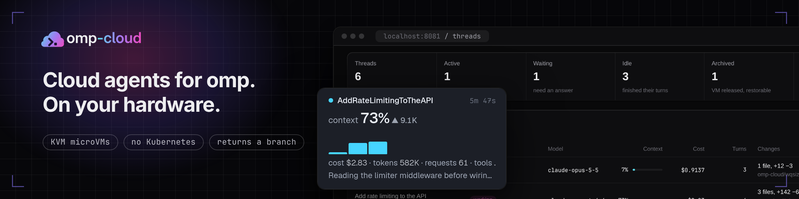
</picture>

**Self-hosted cloud agents for [omp](https://github.com/can1357/oh-my-pi).** `/cloud <task>` hands your repo and conversation to an omp agent in its own KVM microVM on your hardware. It asks you questions, sleeps when idle with its processes intact, and returns a branch.

No Kubernetes, no SaaS: one HTTP service, a [vibemon](https://github.com/stencil-hq/vibemon) pool, and omp's own auth broker and gateway.

[](https://github.com/TechDufus/omp-cloud/releases)
[](https://github.com/TechDufus/omp-cloud/actions/workflows/ci.yml)
[](LICENSE)
[](docs/install.md)
[](docs/install.md)

[Quickstart](#quickstart) · [Dashboard](#the-dashboard) · [Updating](#updating) · [Docs](#documentation) · [Pairing](docs/pairing.md) · [Changelog](CHANGELOG.md) · [omp ↗](https://github.com/can1357/oh-my-pi)

</div>

> [!NOTE]
> Single owner. The service needs a Linux host with KVM. What is untested or unsupported is listed under [Known limitations](docs/architecture.md#known-limitations).

<p align="center">
  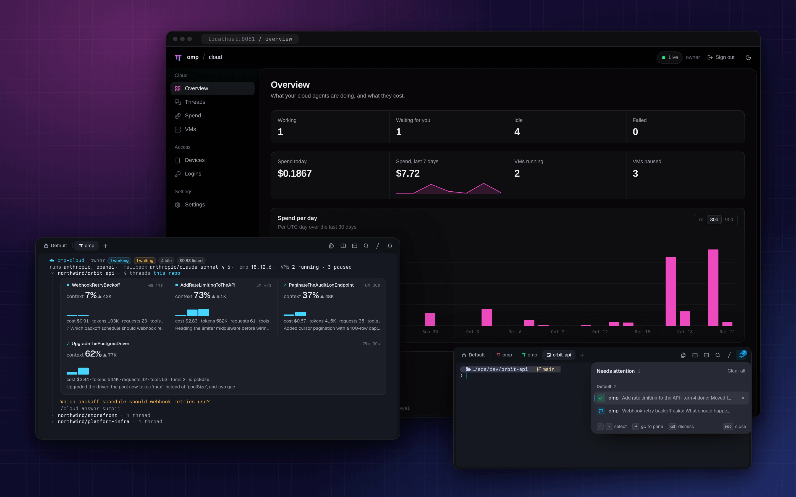
</p>

## What you get

- **Hand off.** The repo state, uncommitted changes included, and the conversation go to an agent in its own microVM, on the same omp binary you run.
- **It asks, you answer.** The agent's `ask` questions come back as omp cards and as a "needs attention" entry in your terminal's tray, and wait for you.
- **Sleeps with its processes intact.** A VM pauses after idle and resumes on the next message; after 7 days idle (the default) it is archived and restored from its last result.
- **Looks like omp's own jobs, and works like omp's agents.** Job tiles with step dots and a live output tail, the jobs pill, `/jobs` and `proc://`; `agent://<id>` and `history://<id>` read a cloud agent's reply and conversation, `write agent://<id>` messages it (and it can write back), and a thread the model started delivers its result as omp's own async-result. `omp stats` counts its spend with yours.
- **A dashboard.** Threads by repository, per-thread context and cost, spend, VMs, devices and settings, in light and dark.
- **Yours, and locked down.** A loopback API listener plus a pinned-TLS remote listener, a per-thread gateway client token, a push policy, an egress allow-list and spend caps.

## A tour

### In omp

`/cloud list` draws each thread as the same job tile omp draws for its own background work: name, what the agent is doing, context use with its trend, a per-turn chart and cost. A question lands as a card that lists its options and opens omp's own ask dialog. Details: [commands](docs/commands.md) and [cloud agents as omp jobs](docs/jobs.md).

<p align="center">
  <picture>
    <source media="(prefers-color-scheme: dark)" srcset="docs/assets/tui-cloud-tiles-dark.png">
    <source media="(prefers-color-scheme: light)" srcset="docs/assets/tui-cloud-tiles-light.png">
    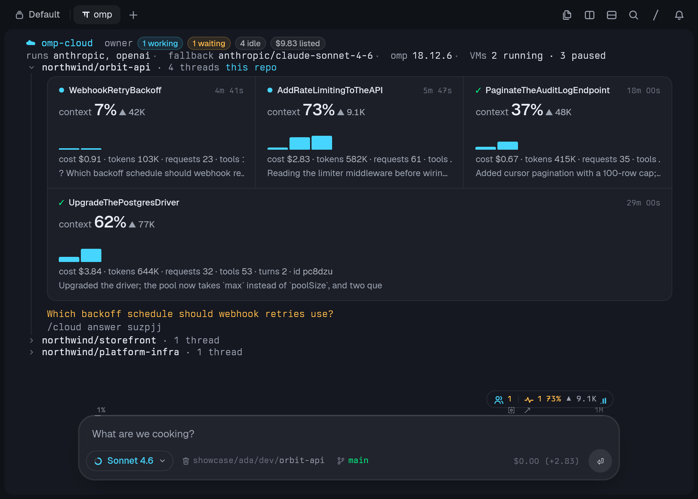
  </picture>
  <picture>
    <source media="(prefers-color-scheme: dark)" srcset="docs/assets/tui-question-card-dark.png">
    <source media="(prefers-color-scheme: light)" srcset="docs/assets/tui-question-card-light.png">
    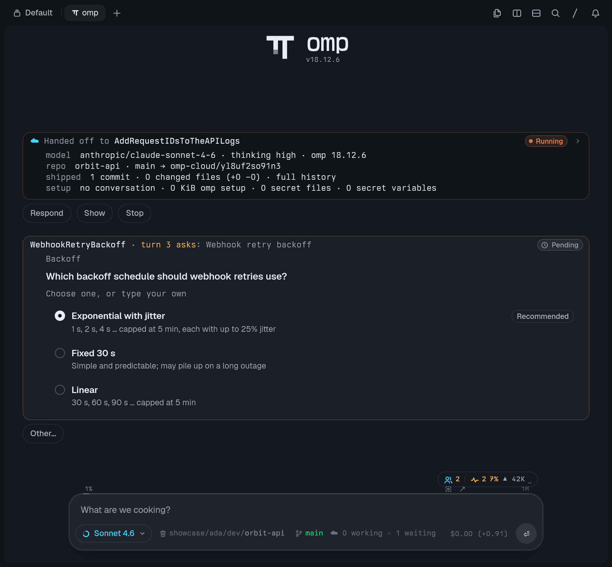
  </picture>
</p>

### The dashboard

`/cloud dashboard` prints a one-time link to a loopback web page styled after omp's own `/stats`. A thread's page shows context use against the model's window, totals, and context and cost per turn.

<p align="center">
  <picture>
    <source media="(prefers-color-scheme: dark)" srcset="docs/assets/dashboard-thread-dark.png">
    <source media="(prefers-color-scheme: light)" srcset="docs/assets/dashboard-thread-light.png">
    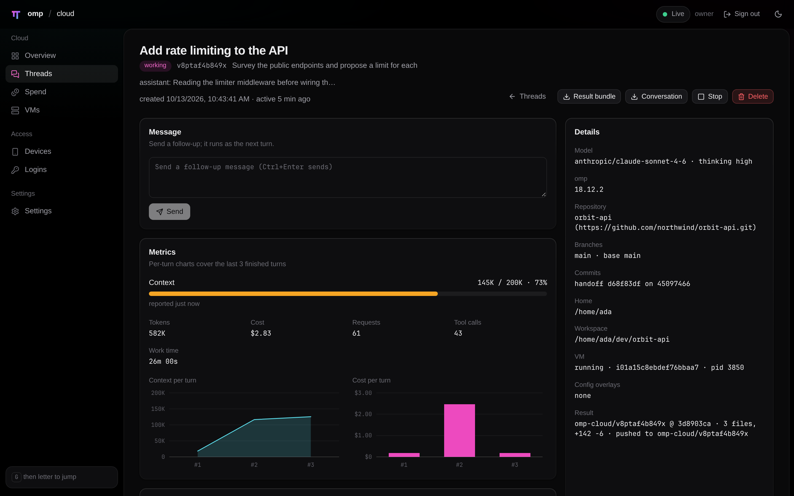
  </picture>
</p>

<details>
<summary>More dashboard pages</summary>

<table>
  <tr>
    <td width="50%"><picture><source media="(prefers-color-scheme: dark)" srcset="docs/assets/dashboard-overview-dark.png"><source media="(prefers-color-scheme: light)" srcset="docs/assets/dashboard-overview-light.png">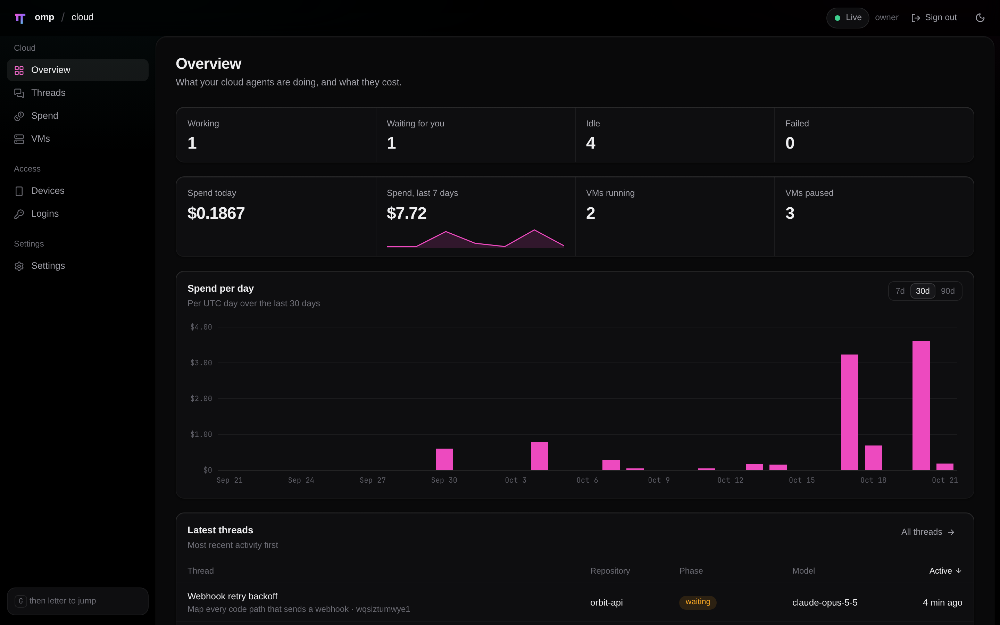</picture><br>Overview</td>
    <td width="50%"><picture><source media="(prefers-color-scheme: dark)" srcset="docs/assets/dashboard-threads-dark.png"><source media="(prefers-color-scheme: light)" srcset="docs/assets/dashboard-threads-light.png">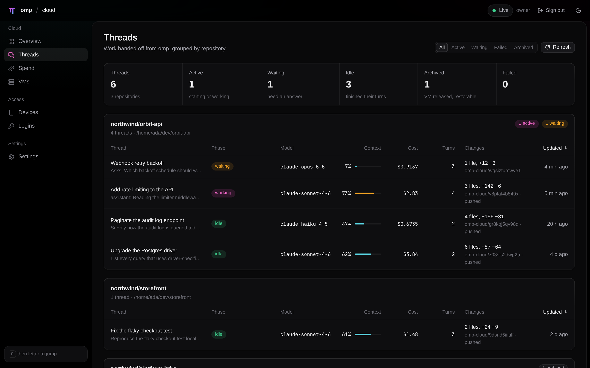</picture><br>Threads</td>
  </tr>
  <tr>
    <td width="50%"><picture><source media="(prefers-color-scheme: dark)" srcset="docs/assets/dashboard-spend-dark.png"><source media="(prefers-color-scheme: light)" srcset="docs/assets/dashboard-spend-light.png">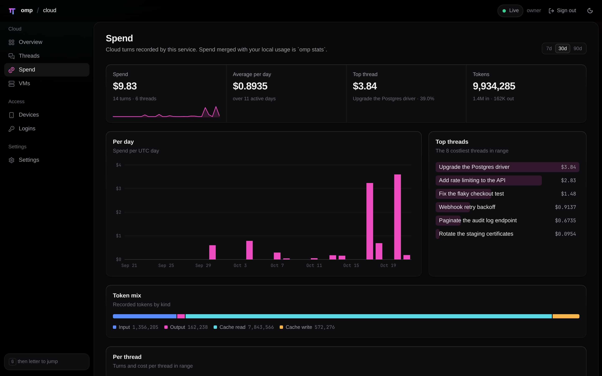</picture><br>Spend</td>
    <td width="50%"><picture><source media="(prefers-color-scheme: dark)" srcset="docs/assets/dashboard-vms-dark.png"><source media="(prefers-color-scheme: light)" srcset="docs/assets/dashboard-vms-light.png">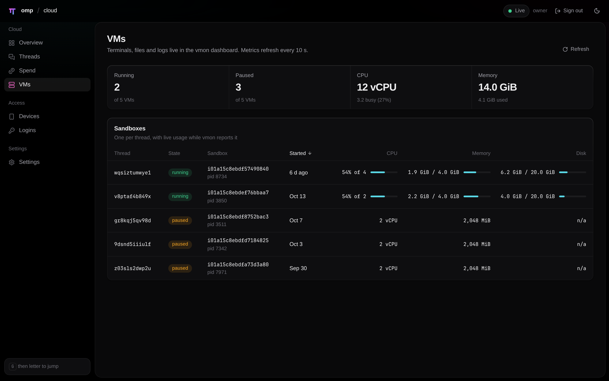</picture><br>VMs</td>
  </tr>
  <tr>
    <td width="50%"><picture><source media="(prefers-color-scheme: dark)" srcset="docs/assets/dashboard-devices-dark.png"><source media="(prefers-color-scheme: light)" srcset="docs/assets/dashboard-devices-light.png">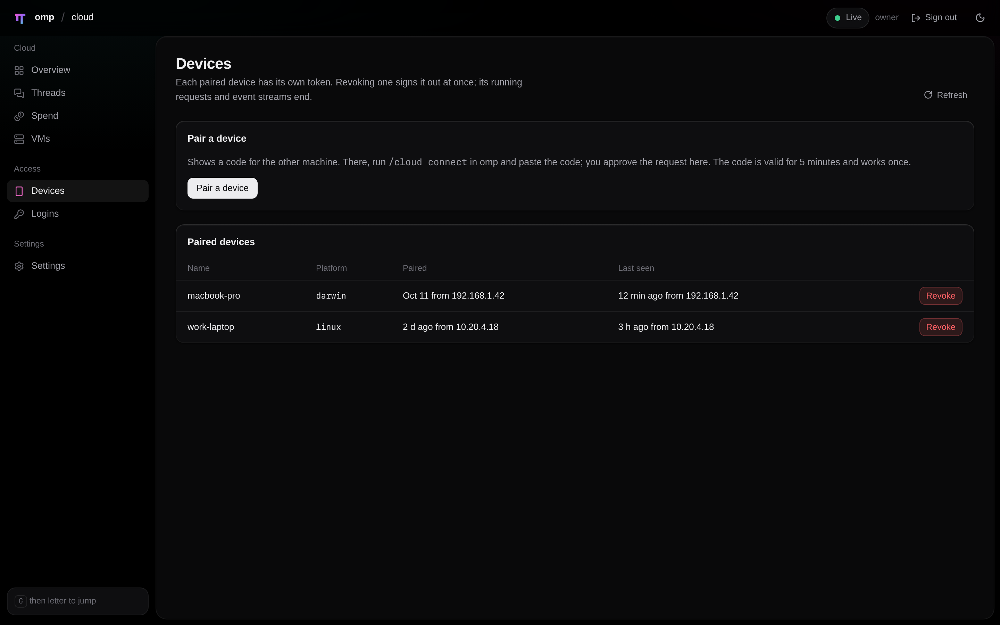</picture><br>Devices</td>
    <td width="50%"><picture><source media="(prefers-color-scheme: dark)" srcset="docs/assets/dashboard-logins-dark.png"><source media="(prefers-color-scheme: light)" srcset="docs/assets/dashboard-logins-light.png">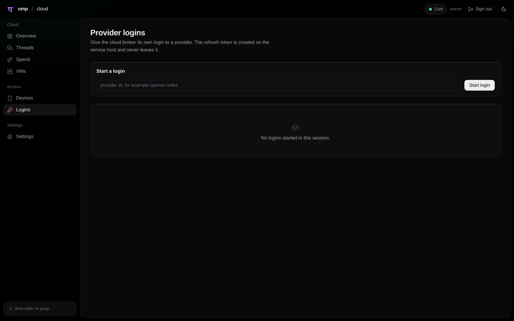</picture><br>Logins</td>
  </tr>
  <tr>
    <td width="50%"><picture><source media="(prefers-color-scheme: dark)" srcset="docs/assets/dashboard-settings-dark.png"><source media="(prefers-color-scheme: light)" srcset="docs/assets/dashboard-settings-light.png">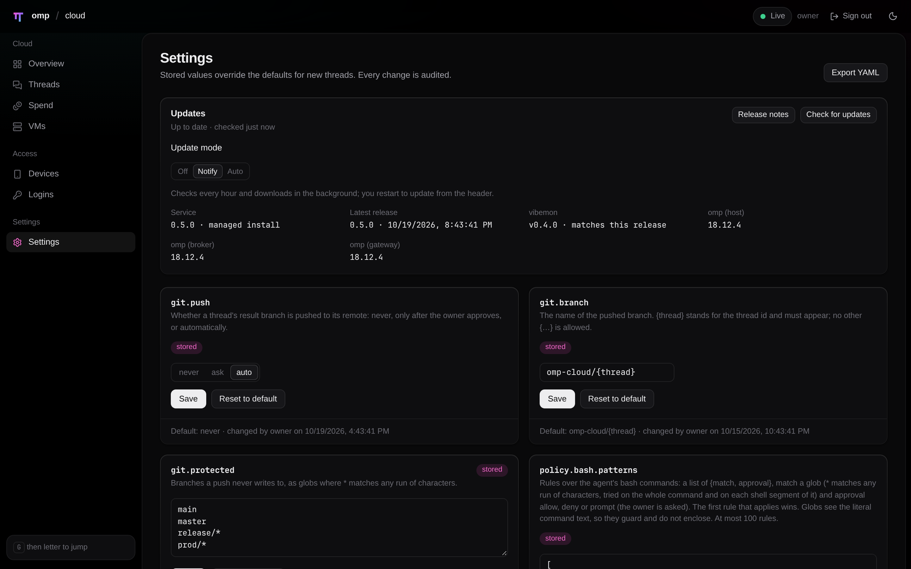</picture><br>Settings</td>
    <td width="50%">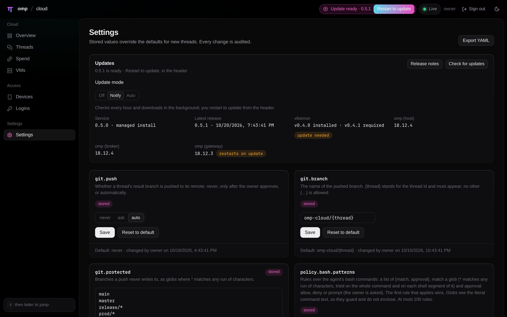<br>Settings, with an update ready</td>
  </tr>
</table>

</details>

### In Tern

A question or a result that arrives while you are in another pane fills the terminal's own attention tray (the Program Status Protocol), so you see it without a card landing in the conversation. Details: [where results go](docs/commands.md#where-results-go).

<p align="center">
  <picture>
    <source media="(prefers-color-scheme: dark)" srcset="docs/assets/tern-bell-tray-dark.png">
    <source media="(prefers-color-scheme: light)" srcset="docs/assets/tern-bell-tray-light.png">
    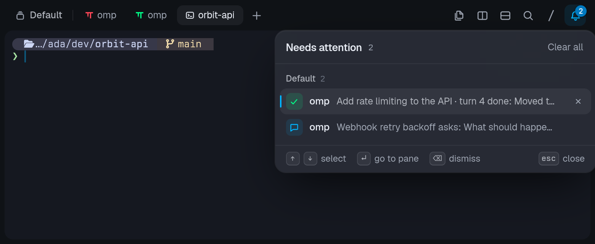
  </picture>
</p>

## How it works

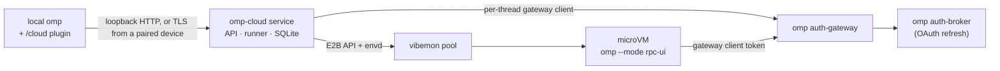

1. **Handoff.** The plugin snapshots the repo as a git bundle, packs the conversation, and ships your omp setup, model and omp version.
2. **Run.** The service gives each thread one microVM running the same omp binary you do; omp runs over RPC and its `ask` questions come back to you.
3. **Idle.** After each turn the service commits the work and stores a result bundle; after the idle timeout it pauses the VM, and a thread nobody touches for 7 days (the default) is [archived](docs/archive.md).
4. **Return.** `/cloud pull <id>` fetches `omp-cloud/<id>` and saves the cloud conversation as a local omp session; `/cloud resume <id>` continues it locally.

The long version, and the features beyond the core loop (push policy, names and jobs, archive, dashboard, pairing, agent policy, settings), is in [`docs/architecture.md`](docs/architecture.md).

## Quickstart

omp-cloud has two roles, each set up once: the **server**, the Linux machine that runs the service and the microVMs, and each **device** you run omp on. One machine can be both. The install script runs on the server and not on your laptop; the laptop is a device ([Server and devices](docs/install.md#server-and-devices)).

### 1. The server (once)

You need a Linux x86_64 machine with `/dev/kvm`, systemd and a user with sudo (asked once), and omp 18.12.3 or newer (setup installs omp when it is missing). On that machine, one command sets up everything there: vibemon, the service, the model login and the plugin in that machine's omp.

```sh
curl -fsSL https://raw.githubusercontent.com/TechDufus/omp-cloud/main/install.sh | sh
```

It prints what it will change and asks first, and it configures only the machine it runs on. For a server you reach over ssh (a homelab box, a VM with nested KVM), run it from where you work; `-t` gives the prompt and sudo a terminal:

```sh
ssh -t user@host 'curl -fsSL https://raw.githubusercontent.com/TechDufus/omp-cloud/main/install.sh | sh'
```

Prefer an agent to do it? [`docs/agent-setup.md`](docs/agent-setup.md) has a prompt to paste into omp for this machine, and one for a remote server that also pairs the machine you work on.

### 2. Each device you work from

On the server itself the plugin is already installed, so step 2 is only for other machines (a laptop, a second workstation). On each, with omp 18.12.3 or newer:

```sh
omp plugin marketplace add TechDufus/omp-cloud
omp plugin install omp-cloud@omp-cloud
```

Then `/restart` omp, and pair once, in omp: `/cloud connect user@host` over ssh (key-based login and a known host key; nothing to approve), or run `/cloud pair` on the server and `/cloud connect <code>` on the device. A private repository or fork needs git access on the device for the marketplace add.

The device reaches the server on TCP 8443. Setup never opens the firewall, so allow that port from the device ([firewall](docs/install.md#firewall)); by default only private addresses may connect. Pairing, public addresses and revoking: [pairing](docs/pairing.md).

### First task

In omp:

```text
/cloud fix the flaky retry test in src/runner
```

The agent starts, asks what it needs, and `/cloud pull <id>` brings its branch home. On the server, `omp-cloud doctor` checks the whole stack, including that your omp loads the plugin, and `omp-cloud uninstall` removes it. To work on omp-cloud itself, `mise install && mise run infra:up` sets a clone up the same way ([install from a checkout](docs/install.md#install-from-a-checkout)).

## Updating

The server and each device update separately ([Updating](docs/updating.md)):

- **The server** updates the way Tern does. It checks the release feed in the background, downloads and verifies a newer release, and shows `Update ready` in the dashboard, the omp footer and `/cloud update`; one click installs it, with a health check and an automatic rollback, and refreshes the server's own plugin. `update.mode: auto` installs by itself only when nothing is running, vibemon and the database schema are unchanged: [`auto`](docs/updating.md#auto). Each release pins the vibemon version it was tested with, and a root helper installs it when it changes. A git checkout updates with `git pull` and a restart.
- **Each device** does not follow the server: the plugin installed from the marketplace moves with `omp plugin upgrade` and a `/restart`, and omp tells you when it is older than the server ([the plugin](docs/updating.md#the-plugin)).

`mise run update:scenario` exercises install, update, rollback of a broken release and a checkout against throwaway releases.

## Security model

- The service has an API listener on loopback only and a remote listener (TLS) for paired devices only. The owner token is refused on the remote listener.
- A VM holds one per-thread gateway client token. Provider credentials and git credentials never enter it, and the VM never pushes.
- VM egress is the internet plus the gateway; every other private range is denied, and `policy.egress` narrows the internet to a list.
- Bash rules, tool approvals and spend caps bound what an agent may do, and a thread can tighten them, never loosen them.

More in [`docs/security.md`](docs/security.md).

## Documentation

| Page | Covers |
|---|---|
| [Install](docs/install.md) | The one-command install, requirements, flags, `doctor`, `login`, `uninstall` |
| [Agent setup](docs/agent-setup.md) | A prompt that has omp or another coding agent do the install with you |
| [`/cloud` commands](docs/commands.md) | The command reference, the inbox and tray, cards and buttons, slash commands in the cloud agent |
| [The `cloud` tool](docs/cloud-tool.md) | What omp's model can do, and scratch threads |
| [Cloud agents as omp jobs](docs/jobs.md) | Job tiles, `wait`, `agent://` and messaging, how results arrive, cancelling |
| [Configuration](docs/configuration.md) | The client config files and `service.json` |
| [Pairing](docs/pairing.md) | Other machines, over a code or ssh |
| [Archive](docs/archive.md) | Idle threads, and the sweep of sandboxes no thread holds |
| [Updating](docs/updating.md) | One-click updates, `auto`, the pinned vibemon, a checkout |
| [Backups and persistence](docs/operations.md) | `mise run backup`, restore, the persistent units |
| [Architecture](docs/architecture.md) | The long version of How it works, and the features beyond the core loop |
| [Security model](docs/security.md) | Trust boundaries and where each control is documented |
| [API](docs/api.md) | The HTTP contract |
| [Development](docs/development.md) | Layout, checks, tasks |
| [AGENTS.md](AGENTS.md), [Changelog](CHANGELOG.md) | Agent notes and verified facts, release notes |

## Related projects

- [omp](https://github.com/can1357/oh-my-pi): the coding agent that runs in the VM and on your machine, and the source of the auth broker and gateway.
- [vibemon](https://github.com/stencil-hq/vibemon) (`vmon`): the microVM manager the service drives through its E2B API.
- [Tern](https://stencil.so): the terminal that renders the cards, buttons and tray natively.

## License

MIT, see [`LICENSE`](LICENSE). Release binaries carry `THIRD-PARTY-NOTICES.txt` for the packages they bundle.
