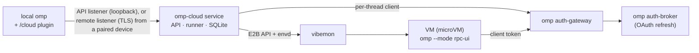

# Architecture

[README](../README.md) · [Documentation index](../README.md#documentation)

> **Scope:** one owner, one vibemon node. The service needs a Linux host with KVM. A thread's VM is a vibemon sandbox, a microVM; this page says VM. The plugin has Windows path handling and is meant to run wherever omp does, but only Linux has been run. Updates and releases are in [Updating](updating.md); what is untested or missing is under [Known limitations](#known-limitations).

## How it works

1. **Handoff.** The plugin snapshots the repo (uncommitted changes included, credential-named files withheld) as a git bundle, forks and packs the conversation (`omp session pack`; a delegation by the model ships none unless it asks, and its agent starts blank like a `task` subagent), and ships your `~/.omp/agent` setup (without its `memories` directory: cloud agents run without memory, [Memory](commands.md#memory)), the session's `--config` overlays, model, thinking level and omp version. For a remote whose host the service holds a credential for, the bundle holds only what the remote lacks: the service fetches the base itself.
2. **Run.** The service gives each thread one VM from the template `omp-agent:<omp version>-<recipe hash>`, built on first use from omp's build service and checksum-verified, so the VM runs the same omp version you do. The recipe is the runner's own tools (`src/vmon/template.ts`), the Debian packages of the `vm.packages` setting (a toolchain with `build-essential`, python3 and node by default), omp, and the root shell lines of `vm.setup` ([Environments](environments.md#the-vm-toolchain)). The hash covers the recipe and the installed vibemon version, so a change to either, a setting included, gives new VMs a new template: the first thread after it waits for a rebuild, and a VM already running from the old template keeps working. A repository that commits a `setup` script starts from a cached [environment](environments.md#per-repository-environments), a snapshot of a VM that ran it, instead of the plain template. omp runs over RPC, with `memory.backend: off` set by the service's config; its `ask` questions come back to you (an agent the model started has no `ask`: it runs as a [subagent](api.md#cloud-subagents) and its final message is its result).
3. **Idle.** After each turn the service commits the work, downloads a result bundle and packs the agent's session; after `runner.idleTimeoutSeconds` (default 600) it pauses the VM. The next message resumes it and reattaches to the same omp process. A thread nobody touches for `lifecycle.archiveAfterDays` (default 7) is archived: its VM is released and everything else is kept ([Archive](archive.md)).
4. **Return.** `/cloud pull <id>` fetches `omp-cloud/<id>` and saves the cloud conversation as a local omp session; `/cloud resume <id>` checks out the branch and continues that session locally. Watched threads save it after every turn, so `omp stats` counts the cloud's spend with yours, each request once. No memory comes back. A VM that is lost is replaced from the last result and conversation, so the thread goes on.

## Features beyond the core loop

- **Push policy.** `git.push` is `never` (default), `ask` or `auto`. The service pushes the result branch (`git.branch`, default `omp-cloud/{thread}`) from its own git cache with a credential only it holds; it never forces and never writes a protected branch or the remote's default branch. Under `ask` the push is a question you answer. A read-only thread is never pushed.
- **GitHub.** Connect a GitHub App once on the dashboard and the service pushes to your private repositories with one-hour installation tokens, re-signs each turn's commits with its own SSH key so GitHub shows them as Verified, and opens and updates a draft pull request after each push. Nothing of it reaches a VM. See [GitHub](github.md).
- **Secrets and MCP.** Configure environment secrets once on the service, each scoped to the repositories (globs) that get it, and the VM receives them as env at provisioning, masked toward the model. The MCP servers your omp uses ship with a handoff: http ones through a proxy on the service that holds their headers and OAuth tokens, stdio ones run in the VM against `${NAME}` secrets. Settings that only make sense on your machine stay on it. See [Secrets and MCP servers](secrets-and-mcp.md).
- **No memory.** The cloud agent starts without memory and returns none. A handoff ships no `~/.omp/agent/memories` and the VM's omp runs with `memory.backend: off`, so every handoff stops shipping the whole local store (all projects) into a VM and a cloud agent cannot write into your local recall. Your local omp keeps its own memory, and what it learns from a cloud result is what it retains itself. See [Memory](commands.md#memory) and [Security model](security.md#memory).
- **Environments and previews.** The toolchain of every VM is two settings (`vm.packages`, `vm.setup`). A repository's `.omp-cloud.yml` can add a `setup` script that the service runs once in a throwaway VM and keeps as a vibemon snapshot, keyed by the template, the repository, the script and the contents of the lockfiles, so later threads start with their dependencies installed. `/cloud preview <id> <port>` opens a dev server the cloud agent runs in its VM on your machine, through the service. See [Environments and previews](environments.md), [API](api.md#environments-and-previews) and [Security model](security.md#environments-and-previews).
- **Names and jobs.** Every thread gets a short name (at most 60 characters, such as `Pane zoom shortcut`) that omp's own title model writes when you hand off; the id stays, and every list shows the name first. A cloud agent behaves like one of omp's own subagents: `/cloud list` draws job tiles like omp's, a running turn shows in the jobs pill, `/jobs` and `proc://`, the model can `wait` on it, `agent://<id>` and `history://<id>` read it, and `write agent://<id>` messages it (it can write to `agent://Parent` in return) through the service's IRC endpoint and the VM extension. See [Cloud agents as omp jobs](jobs.md).
- **Dashboard.** `/cloud dashboard` prints a one-time link to a loopback web page and, from a terminal UI, opens it in your browser. Pages: Overview, Threads (grouped by repository, with context and cost per thread and an Archived filter), Spend, VMs, Devices, Logins, GitHub, Secrets and Settings, in a light or dark theme that follows your system unless you pick one. A thread's page has a Metrics card: context use against the model's window, totals (cost, tokens, tool calls, work time) and context and cost per turn. A running omp loads plugin code at start, so after a plugin update `/restart` omp.
- **Pairing.** Other machines pair once with a code (`/cloud pair` here, `/cloud connect` there) and get their own revocable token over a pinned TLS connection; see [Pairing](pairing.md).
- **Agent policy.** Bash rules and tool approvals (a `prompt` rule becomes a question to you), per-turn, per-thread and per-day spend caps, an egress allow-list, allowed models and read-only threads (no push, no pull request, no MCP servers); see [API](api.md#agent-policy). VMs never push: `git push` and remote edits are blocked in the VM as a second guard.
- **Settings in the database.** Run-time settings are edited through `/api/v1/settings` or the dashboard, applied without a restart, audited, and exportable as YAML. `service.json` keeps what the service needs to start ([Configuration](configuration.md)).

Trust boundaries and the pairing and policy details are in [Security model](security.md).

## Design

Why the system is shaped this way; each point links to where it is specified.

- **The store is the system of record.** The API only writes intents (queued turns, stop requests, answers, deletions) and their lifecycle events to SQLite in one transaction; the runner works from the stored state and its change feed. A restart loses nothing, and the API and runner do not call each other. One thread runner per thread serializes every VM operation of its thread.
- **E2B API only, omp inside the VM.** The service talks to vibemon only through the E2B API. omp runs in the VM over RPC (`omp --mode rpc-ui`).
- **No credentials in the VM.** A VM holds one per-thread gateway client token (revoked with the thread). Provider logins live in the cloud broker, which has its own OAuth login and never a copy of yours; git credentials stay in the service, which fetches bases and pushes results itself, so a VM only receives and produces bundles. What else a VM holds is what you scope to it: secrets whose repositories match, and stdio MCP server env. An http MCP server's headers and OAuth tokens stay in the service, which makes the call. See [Security model](security.md).
- **Delta handoffs.** For a remote whose host the service holds a credential for, the plugin ships only what the remote lacks and the service fetches the base into its git cache, then composes a full-history bundle each time it provisions a VM for the thread. This keeps uploads small without trusting the client's idea of the base; a remote the service has no credential for ships its whole history. See [API](api.md#creating-a-thread).
- **Push policy.** The VM never pushes. `git.push` is `never`, `ask` or `auto`; the service pushes from its cache, never forces, and refuses protected branches and the remote's default branch, because a pushed branch cannot be taken back. A read-only thread is never pushed whatever `git.push` says. `bash.patterns` in the VM is only a second guard: its globs can be evaded, so the boundaries are the missing credentials, the push policy and egress. See [API](api.md#push-policy).
- **The service signs and opens pull requests, never the VM.** The VM commits as it always did; after each turn the service re-signs that turn's commits with a key only it holds, and the VM adopts the signed tip so the next turn builds on it. The stored result, the recorded head, the push and the pull request therefore all name the same commits, and a failed signing leaves the unsigned result in place rather than a head nobody has. See [GitHub](github.md#signed-commits).
- **The service holds MCP credentials, the VM holds a name.** An http MCP server is reached through a proxy on the gateway address under a per-provisioning bearer, so the VM can use a server without ever having its token, and the service decides what the proxy may reach (never the service host). Secrets are scoped by an explicit repository list with no default, and delivered as an env file omp is started under whenever a VM is provisioned. See [Secrets and MCP servers](secrets-and-mcp.md).
- **A cloud agent cannot write into your local recall.** The VM's omp has memory off, and no export of the VM's state is merged into anything on your machine: what comes home is a result branch and a conversation. See [Security model](security.md#memory).
- **An environment is built before any agent runs, and read-only after.** The service builds a repository's environment from the handoff commit in a sandbox that no thread owns (`app: omp-cloud-env`), and a thread's VM is created from a copy of the result, so nothing an agent does can reach the next thread's environment. Only a thread's first VM builds: a restore or an archive revival starts from the template and never waits for a build, and a failed build never blocks a thread. The key hashes what the script is allowed to depend on (template, repository, script, cache files) and nothing else, which is why a lockfile change rebuilds and a source change does not. See [Environments](environments.md#per-repository-environments).
- **Settings live in the database.** Run-time settings are typed registry keys stored only when they differ from the default, applied without a restart and audited; `service.json` keeps what the service needs to start. See [Configuration](configuration.md) and [API](api.md#settings).
- **A thread may only tighten policy.** A create request can add its own policy, but it is laid over the service's at each use (VM overlay, egress at sandbox creation, spend checks, model check, the push step), so a client can narrow what the owner allows and never widen it, and a later change of the service's policy still applies. `readOnly` is the example of tightening by OR: on when either the service or the thread turns it on. See [API](api.md#agent-policy).
- **Plan mode delegates read-only agents, and they stay read-only for life.** A read-only thread is never pushed and gets no MCP servers, so a plan cannot change anything through a cloud agent; the model's `pull` and its messages to agents that are not read-only (which would wake them and push) are refused in plan mode too. Work that should land is delegated again after the plan is approved. See [The `cloud` tool](cloud-tool.md#plan-mode) and [Security model](security.md#read-only-agents-and-plan-mode).
- **A model's cloud agent is a subagent.** An agent the model starts begins blank, has no `ask` tool (omp reads `ask.enabled` from the overlay the service writes) and returns its final message as its result, which reaches the model as a `<task-result>` like a `task` subagent's, so the model delegates, waits and reads results the way it does for local agents. See [The `cloud` tool](cloud-tool.md) and [API](api.md#cloud-subagents).
- **Three listeners.** The API listener is loopback HTTP. It is the only listener that accepts the owner token as a bearer (the dashboard listener's `POST /session` also takes it, to open a session), so that token stays the service host's credential. Other machines use the remote listener, TLS with a self-signed certificate pinned at pairing and a revocable per-device token, so no domain, certificate authority or extra daemon is needed. It refuses the gateway address, where every VM's traffic arrives from. See [API](api.md#listeners), [Pairing](pairing.md) and [API](api.md#devices-and-pairing).
- **A second `serve` touches nothing.** `serve` binds the API address first (answering `503` until the app is ready) and only then opens the store, issues its gateway client and starts the runner. `omp-cloud` with no command is `serve`, so a second process on a running host would otherwise run the migrations, the orphan sweep and `GatewayModels.start()` (which replaces the service's own gateway client entry with a new token the running service does not know) before failing on the taken port. See [API](api.md#the-omp-cloud-command).
- **The service heals its own gateway client.** The service reads the gateway's model list with a client token that exists only in its memory (the clients file holds a hash). If the gateway answers `401` to that token after the 20 s the gateway gets to pick up a fresh client (it re-reads its clients file every 10 s), something else replaced the entry; the service issues a new client, logs it once, retries every second until the gateway accepts it, and keeps the last model list meanwhile. A `401` inside the window after an issue is the normal wait and never triggers another issue.
- **Updates move the whole stack, but vibemon only with a release.** The updater checks a feed, downloads and verifies a release, stages it, swaps it atomically, health-checks it and rolls back on failure. A release pins the vibemon it was tested with ([vibemon is pinned](updating.md#vibemon-is-pinned)), and `auto` installs only when that costs no one anything ([`auto`](updating.md#auto)). See [Updating](updating.md).
- **Cloud agents are omp agents.** Each followed thread is an agent in omp's registry and its running turn is an `AsyncJobManager` job, so omp's own `agent://`, `history://`, `proc://`, `wait` and IRC paths reach it. Messages go through the service's IRC endpoint and the VM extension. A cancel from omp's job surfaces stops the cloud turn, but omp's own cleanup (`/clear`, a new session, a switch) cancels jobs with the same reason, so the plugin tells them apart by omp's session-transition state and leaves the turn running. See [Cloud agents as omp jobs](jobs.md#cancelling) and [Security model](security.md).
- **Runtime imports must be ones a compiled omp serves.** A compiled omp has no `node_modules` for an extension; it answers `@oh-my-pi/*` imports from a registry built from its packages' exports. The plugin and the VM extension therefore import only served modules (`plugin/test/host-imports.test.ts` is the gate), and the plugin's entry is a thin loader that reports the real error when `main` fails to load. See [Development](development.md).

## Known limitations

Current limits, and what has only been exercised by unit tests or a partial scenario.

**Not run or not verified**

- Only Linux has been run. The plugin has Windows path handling and no macOS-specific code, and CI runs on Linux only; Windows, macOS and WSL are untested for the plugin.
- The arm64 binary is built but not run, and the vibemon helper installs only x86_64.
- `install:scenario` with nested VMs has not completed on any host. Where nested KVM kills the clean VM it runs with `--no-nested`, which skips the template build and a real turn inside the clean VM. A real reboot is not run (a vibemon guest does not survive `reboot`), so the scenario checks enabled units, their `WantedBy`, linger and the user units' wants instead.
- `update:scenario` runs real compiled releases against a static feed, with vibemon already at the pin, no schema change, `update.mode` `off` and `update.ompUnits` empty. The updater's use of the root helper to move vibemon, its `backup` step, a database restore on rollback, the `omp` step and `auto` against a real service are covered by unit tests only. The dashboard's update pill and card were checked against scripted routes (`mise run dashboard:dev`).
- How Tern paints the hub's `list`/`item` nodes, the cards, the Subagents strip, the ask dialog and the update card's button is not seen in Tern itself. omp's side of each is checked in a real omp by `mise run parity:capture` (the classic renderer, and omp's own reference applier for Tern's protocol).
- Failure paths covered only by unit tests: omp dying twice, the turn timeout, retries while vibemon is unreachable, reconcile of stray sandboxes and gateway clients, a completed `/cloud login`, idempotent create across two service processes or a crash between insert and response, and the deleted and stale notices in a real omp.
- Only one vibemon node is set up and tested; a VM's network limits across nodes are untested.
- A resume of a VM the service knew was paused drops all of its connections, but a sandbox that vibemon paused at its own timeout while the service record still says running (or after a service restart) gets only the address-based drop: if another sandbox took its address and was killed meanwhile, the resumed omp can still hang on a connection the host never acknowledges, until the turn times out.
- Two independent OAuth logins on one provider account worked at login time but have not been watched through independent refreshes. Whether running agents unattended on a subscription is allowed is up to your provider's terms.
- The binary half of `plugin/test/host-imports.test.ts` runs only where Tern's compiled omp binaries are installed; elsewhere, and in CI, only the check derived from the pinned packages' exports runs.

**Install and release**

- `install.sh` sends no credentials, so it can download only from a repository whose releases are public. A private repository or fork needs `update.token` to follow updates, and `install.sh` cannot fetch its assets.
- The default feed reads GitHub's `latest` release, which skips prereleases and drafts, so the default feed never offers a prerelease tag. A static feed serves whatever its `release.json` holds.
- omp-cloud never deletes or renames a vibemon team (vibemon cannot), so a team left behind stays in vibemon: a wrongly named one, or the old one after `--migrate-team`.
- The broker and gateway keep running the omp they started with after the host's omp moves on, and setup restarts a persistent unit only when its rendered file changes; restart them after an omp upgrade (the update's `omp` step does it for an update).
- The service reissues its own gateway client on every start, because only a token's hash is stored; the gateway re-reads its clients file every 10 s, so the model list can take up to 10 s to be ready after a start.
- A template build downloads omp from omp's build service, so the first thread on an omp version with no template needs it reachable from the build. Built tags do not.
- The VM's toolchain is the `vm.packages` and `vm.setup` settings ([Environments](environments.md#the-vm-toolchain)) over the runner's fixed tools (`src/vmon/template.ts`); the base image is fixed (Debian trixie). Plugin-installed omp extensions are not shipped to VMs; the launch warning names each enabled one.

**Data and operations**

- Backups carry every thread's `secrets.json` (shipped secret files, env values and MCP server headers) and the database's `secrets` and `mcp_credentials` tables (literal secrets and MCP OAuth tokens), all unencrypted, on the same disk as the data directory. Never sync the backups directory off the host without encrypting it.
- A VM keeps its egress for life: `policy.egress` reaches new VMs only, and a thread's own `egress` entries are matched as exact lowercase strings, so a thread cannot name a narrower address inside a service CIDR or wildcard entry.
- A delta thread's VM needs a full-history bundle that the service composes each time it provisions a VM (the first one and every restore or replacement). One over 1 GiB is refused although the delta upload was small, and a restore needs the git cache to still hold the thread's handoff.
- Events are append-only with no cap per thread until the thread is deleted, and the event stream sends its backlog without backpressure. The SDK's stdout buffer is bounded per turn, but one very long turn still buffers its own output.
- A service whose data directory is deleted while threads are open leaves their sandboxes and gateway clients behind (reconcile touches only its own service id). Delete threads, or run `omp-cloud uninstall --purge`, before discarding a data directory.
- The dashboard's session cookie (`omp_cloud_session`) is scoped by host, not port, so another local server on 127.0.0.1 shares it (the guard refuses its cross-site requests). The sign-in rate limiter is global: 5 failed sign-ins in 60 s lock sign-in out for everyone until the window passes (denial of service only).
- Once a local copy of a thread's session export is the current session, was continued, or is held by another omp, background saves skip that thread, so `omp stats` sees its later cloud turns only after an explicit `/cloud pull` or `/cloud resume`, which saves it as a new omp fork that the plugin never cleans up.
- Extensions shipped into the VM may emit UI requests beyond approvals; the runner cancels every `select`, `confirm`, `input` and `editor` that is not an approval.

**GitHub and signing**

- Only github.com is supported; GitHub Enterprise Server hosts are not. The App flow, installation tokens, pull requests and the Verified badge are covered by unit tests against a scripted GitHub API, and the scenario verifies a signed result with git locally; nothing in the test suite talks to github.com, so the first real connection is yours to check.
- The App has no Workflows permission, so GitHub refuses a push that adds or changes `.github/workflows/*`; the turn records the refusal as `pushError`. This is deliberate: an agent cannot rewrite CI to reach repository secrets. Pull such a branch with `/cloud pull` and push it yourself.
- An App owned by an organization has no noreply address to commit as, so commits keep their own committer and are not Verified until `git.committer` names an address verified on the account that holds the signing key. For a user-owned App the service uses the owner's noreply address.
- There is one signing key for the whole service and only SSH signatures (no GPG, no per-user keys). Verified needs that key added to the GitHub account as a Signing Key; the dashboard can check registration only for a user-owned App.
- Signing and the pull request run on the service after the turn. If the service cannot store the signed bundle after the VM adopted it, the VM keeps the signed tip while the store keeps the unsigned result; the next turn's bundle covers both. A pull request opens only after a push (`git.push` `ask` or `auto`) to a repository the App is installed on; on another repository the `pr` event says `pull request failed: …` with the install link, and the push itself still follows the `git.hosts` fallback.
- A pull request closed without merging is never reopened or replaced, so closing one is how you stop the service opening pull requests for that branch.
- The handoff commit is signed with your own git configuration only when `commit.gpgsign` is true; a prompt that takes longer than 30 seconds falls back to an unsigned handoff commit and a warning.

**Secrets and MCP**

- The MCP proxy resolves an upstream host to refuse addresses of the service host and then connects with a separate lookup, so a DNS name that answers differently between the two (rebinding) can pass the check. Whoever controls the DNS of a name an http MCP server uses could reach a service-host port that way; the check at create time and the one on every request shrink the window and do not close it. Redirects are never followed.
- A secret reaches a VM only when the VM is provisioned (creation, restore, archive revival). A changed or deleted secret does not reach a running or paused VM, and a deleted one is not removed from it.
- Masking is string replacement toward the model: a value shorter than 4 characters, a transformed value (encoded, split) and a value written into a file, commit or network request are not masked. The VM's agent can always read its own environment.
- Literal secrets and MCP OAuth tokens are stored as text in the service database, like `update.token`. There is no secret audit trail beyond `updatedBy` and `updatedAt`, no route to remove or list the details of an MCP login (`whoami.mcpLogins` lists the URLs), and no record of what an MCP server was asked.
- Only http and stdio MCP servers ship: SSE servers, loopback URLs and servers whose stdio `env` holds literal values stay home with a launch warning. A stdio server needs its runtime in the VM (the default template has node, npm, python3 and the runner's git, curl and jq; anything else comes from `vm.packages` or `vm.setup`), and only its `env` is checked for credentials, not its `args`.
- One bearer token serves all of a thread's http MCP servers until the next provisioning replaces it.
- An MCP login is the service's, per exact URL, and covers every thread that ships that URL without its own `Authorization` header. A failed refresh sends no token and the server's `401` reaches the agent; log in again. The flow is omp's own and is covered by unit tests with scripted endpoints: nothing in the test suite signs in to a real MCP server's OAuth, so the first real login is yours to check. A server that pins a client id and a fixed redirect port can fail to log in; its static headers still work.
- Upstream responses reach the VM as the runtime decoded them (`content-encoding` and `content-length` are dropped), and the runtime's `fetch` negotiates its own `Accept-Encoding` with the upstream: the VM's is not forwarded.

**Memory**

- Cloud agents run without memory: the VM's omp does not recall what you retained locally, and what a thread learns stays in its conversation and branch. Put what it needs into the task or the repository's `AGENTS.md`.

**Environments and previews**

- A preview does not forward websockets (`501`): a page loads, but a dev server's hot-reload socket does not connect. Plain HTTP, streaming and server-sent events work. A preview is reached through a forwarder on your machine, so it needs `localhost:<port>` and the plugin; there is no URL the browser can open without it.
- Only a thread's first VM builds its environment. A restore after a lost VM and an archive revival use a cached environment when one exists and never build one, so without it the agent installs dependencies itself, as it did before. A thread whose build failed has none until the first VM of a later thread builds it.
- An environment is keyed by the template, the repository, the script and the cache files at the handoff commit, not by the rest of the tree: a script that reads other files is cached by the cache files alone, and a changed source file never rebuilds it. Add such a file to `cacheFiles`, or change the script, to rebuild. Nothing lists or deletes environments by hand in this release; eviction and a template change retire them.
- Each environment is a full-disk vibemon snapshot, kept in vibemon's storage on the service host (under `/var/lib` for a default install) and not in the [backups](operations.md). At most 20 are kept: after each build the ones built on another template go first, then the one used least recently, so more than twenty repositories in regular use rebuild each other's environments. A restored database may name a snapshot that is gone; the thread's VM then starts from the template with a `notice`.
- The build sandbox counts toward the team's concurrent-sandbox limit while it runs, takes the thread's egress policy, and is stopped after 30 minutes. A service that dies mid-build leaves the sandbox until the first lifecycle sweep after it is 2 hours old.
- Whatever a setup script writes to disk is in the snapshot, and so in every VM started from it, including a secret the script wrote to a file. The repository's Secrets are in its environment while it runs. Both are in [Security model](security.md#environments-and-previews).
- A change to `vm.packages` or `vm.setup` leaves already running or paused VMs on their old template, and retires the environments built on it, so each repository's next first VM builds its environment again.

**Cloud agents as omp jobs**

- The plugin reaches omp internals: `AsyncJobManager` (`register`'s options, `acknowledgeDeliveries`, `cancel`, the `widgets` slot), the `AgentProgress` shape, and the members of an agent session that omp's paths read (`SHIM_MEMBERS`). omp documents none of it as an extension API, so a new omp can break it; the pinned omp packages, `plugin/test/cloud-jobs.test.ts`, `cloud-agents-omp.test.ts` and `plugin:scenario` are the check. `plugin/src/session-sync.ts` likewise relies on omp's lease and its unpack prefix rule.
- A cloud job's clock starts when your omp registers it, not when the cloud turn started.
- Subagent children start from the "Spawned agent `X` (job `Y`)" text of a tool result, so a wording change in omp stops them; background `bash` and `eval` children start from `details.async`. A task child's progress needs an omp with `set_subagent_subscription`. An end the runner infers (the agent read the job's result itself, or omp reports no background work left) is a guess and cannot tell completed from cancelled.
- A cloud `bash` child shows no output and no Directory fact (the service reports state, not output). A thread that is already idle when your session starts following it is not followed, so its running children are not seen until it is active again. There is no remote cancel for a child ([Cancelling](jobs.md#cancelling)).
- IRC edges: a message handed to omp at the instant the agent finishes its turn can start an untracked turn in the VM, and a repeated message id whose first answer was `revived` answers `woken` with the same turn.
- Tern has no public host protocol for agent sessions, so Tern-hosted agent sessions are out of scope; only its managed omp install is used.

