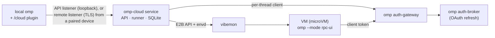

# Architecture

[README](../README.md) · [Documentation index](../README.md#documentation)

> **Scope:** one owner, one vibemon node. The service needs a Linux host with KVM. A thread's VM is a vibemon sandbox, a microVM; this page says VM. The plugin has Windows path handling and is meant to run wherever omp does, but only Linux has been run. Updates and releases are in [Updating](updating.md); what is untested or missing is under [Known limitations](#known-limitations).

## How it works

1. **Handoff.** The plugin snapshots the repo (uncommitted changes included, credential-named files withheld) as a git bundle, forks and packs the conversation (`omp session pack`), and ships your `~/.omp/agent` setup, the session's `--config` overlays, model, thinking level and omp version. For a remote whose host the service holds a credential for, the bundle holds only what the remote lacks: the service fetches the base itself.
2. **Run.** The service gives each thread one VM from the template `omp-agent:<omp version>-<recipe hash>`, built on first use from omp's build service and checksum-verified, so the VM runs the same omp version you do. The hash covers the recipe (`src/vmon/template.ts`) and the installed vibemon version, so a change to either gives new VMs a new template. omp runs over RPC; its `ask` questions come back to you.
3. **Idle.** After each turn the service commits the work, downloads a result bundle and packs the agent's session; after `runner.idleTimeoutSeconds` (default 600) it pauses the VM. The next message resumes it and reattaches to the same omp process. A thread nobody touches for `lifecycle.archiveAfterDays` (default 7) is archived: its VM is released and everything else is kept ([Archive](archive.md)).
4. **Return.** `/cloud pull <id>` fetches `omp-cloud/<id>` and saves the cloud conversation as a local omp session; `/cloud resume <id>` checks out the branch and continues that session locally. Watched threads save it after every turn, so `omp stats` counts the cloud's spend with yours, each request once. A VM that is lost is replaced from the last result and conversation, so the thread goes on.

## Features beyond the core loop

- **Push policy.** `git.push` is `never` (default), `ask` or `auto`. The service pushes the result branch (`git.branch`, default `omp-cloud/{thread}`) from its own git cache with a credential only it holds; it never forces and never writes a protected branch or the remote's default branch. Under `ask` the push is a question you answer.
- **Names and jobs.** Every thread gets a short name (at most 60 characters, such as `Pane zoom shortcut`) that omp's own title model writes when you hand off; the id stays, and every list shows the name first. A cloud agent behaves like one of omp's own subagents: `/cloud list` draws job tiles like omp's, a running turn shows in the jobs pill, `/jobs` and `proc://`, the model can `wait` on it, `agent://<id>` and `history://<id>` read it, and `write agent://<id>` messages it (it can write to `agent://Parent` in return) through the service's IRC endpoint and the VM extension. See [Cloud agents as omp jobs](jobs.md).
- **Dashboard.** `/cloud dashboard` prints a one-time link to a loopback web page and, from a terminal UI, opens it in your browser. Pages: Overview, Threads (grouped by repository, with context and cost per thread and an Archived filter), Spend, VMs, Devices, Logins and Settings, in a light or dark theme that follows your system unless you pick one. A thread's page has a Metrics card: context use against the model's window, totals (cost, tokens, tool calls, work time) and context and cost per turn. A running omp loads plugin code at start, so after a plugin update `/restart` omp.
- **Pairing.** Other machines pair once with a code (`/cloud pair` here, `/cloud connect` there) and get their own revocable token over a pinned TLS connection; see [Pairing](pairing.md).
- **Agent policy.** Bash rules and tool approvals (a `prompt` rule becomes a question to you), per-turn, per-thread and per-day spend caps, an egress allow-list and allowed models; see [API](api.md#agent-policy). VMs never push: `git push` and remote edits are blocked in the VM as a second guard.
- **Settings in the database.** Run-time settings are edited through `/api/v1/settings` or the dashboard, applied without a restart, audited, and exportable as YAML. `service.json` keeps what the service needs to start ([Configuration](configuration.md)).

Trust boundaries and the pairing and policy details are in [Security model](security.md).

## Design

Why the system is shaped this way; each point links to where it is specified.

- **The store is the system of record.** The API only writes intents (queued turns, stop requests, answers, deletions) and their lifecycle events to SQLite in one transaction; the runner works from the stored state and its change feed. A restart loses nothing, and the API and runner do not call each other. One thread runner per thread serializes every VM operation of its thread.
- **E2B API only, omp inside the VM.** The service talks to vibemon only through the E2B API. omp runs in the VM over RPC (`omp --mode rpc-ui`).
- **No credentials in the VM.** A VM holds one per-thread gateway client token (revoked with the thread). Provider logins live in the cloud broker, which has its own OAuth login and never a copy of yours; git credentials stay in the service, which fetches bases and pushes results itself, so a VM only receives and produces bundles. See [Security model](security.md).
- **Delta handoffs.** For a remote whose host the service holds a credential for, the plugin ships only what the remote lacks and the service fetches the base into its git cache, then composes a full-history bundle each time it provisions a VM for the thread. This keeps uploads small without trusting the client's idea of the base; a remote the service has no credential for ships its whole history. See [API](api.md#creating-a-thread).
- **Push policy.** The VM never pushes. `git.push` is `never`, `ask` or `auto`; the service pushes from its cache, never forces, and refuses protected branches and the remote's default branch, because a pushed branch cannot be taken back. `bash.patterns` in the VM is only a second guard: its globs can be evaded, so the boundaries are the missing credentials, the push policy and egress. See [API](api.md#push-policy).
- **Settings live in the database.** Run-time settings are typed registry keys stored only when they differ from the default, applied without a restart and audited; `service.json` keeps what the service needs to start. See [Configuration](configuration.md) and [API](api.md#settings).
- **A thread may only tighten policy.** A create request can add its own policy, but it is laid over the service's at each use (VM overlay, egress at sandbox creation, spend checks, model check), so a client can narrow what the owner allows and never widen it, and a later change of the service's policy still applies. See [API](api.md#agent-policy).
- **Three listeners.** The API listener is loopback HTTP. It is the only listener that accepts the owner token as a bearer (the dashboard listener's `POST /session` also takes it, to open a session), so that token stays the service host's credential. Other machines use the remote listener, TLS with a self-signed certificate pinned at pairing and a revocable per-device token, so no domain, certificate authority or extra daemon is needed. It refuses the gateway address, where every VM's traffic arrives from. See [API](api.md#listeners), [Pairing](pairing.md) and [API](api.md#devices-and-pairing).
- **Updates move the whole stack, but vibemon only with a release.** The updater checks a feed, downloads and verifies a release, stages it, swaps it atomically, health-checks it and rolls back on failure. A release pins the vibemon it was tested with ([vibemon is pinned](updating.md#vibemon-is-pinned)), and `auto` installs only when that costs no one anything ([`auto`](updating.md#auto)). See [Updating](updating.md).
- **Cloud agents are omp agents.** Each followed thread is an agent in omp's registry and its running turn is an `AsyncJobManager` job, so omp's own `agent://`, `history://`, `proc://`, `wait` and IRC paths reach it. Messages go through the service's IRC endpoint and the VM extension. A cancel from omp's job surfaces stops the cloud turn, but omp's own cleanup (`/clear`, a new session, a switch) cancels jobs with the same reason, so the plugin tells them apart by omp's session-transition state and leaves the turn running. See [Cloud agents as omp jobs](jobs.md#cancelling) and [Security model](security.md).
- **Runtime imports must be ones a compiled omp serves.** A compiled omp has no `node_modules` for an extension; it answers `@oh-my-pi/*` imports from a registry built from its packages' exports. The plugin and the VM extension therefore import only served modules (`plugin/test/host-imports.test.ts` is the gate), and the plugin's entry is a thin loader that reports the real error when `main` fails to load. See [Development](development.md).

## Known limitations

Current limits, and what has only been exercised by unit tests or a partial scenario.

**Not run or not verified**

- Only Linux has been run. The plugin has Windows path handling and no macOS-specific code, and CI runs on Linux only; Windows, macOS and WSL are untested for the plugin.
- The arm64 binary is built but not run, and the vibemon helper installs only x86_64.
- `install:scenario` with nested VMs has not completed on any host. Where nested KVM kills the clean VM it runs with `--no-nested`, which skips the template build and a real turn inside the clean VM. A real reboot is not run (a vibemon guest does not survive `reboot`), so the scenario checks enabled units, their `WantedBy`, linger and the user units' wants instead.
- `update:scenario` runs real compiled releases against a static feed, with vibemon already at the pin, no schema change, `update.mode` `off` and `update.ompUnits` empty. The updater's use of the root helper to move vibemon, its `backup` step, a database restore on rollback, the `omp` step and `auto` against a real service are covered by unit tests only. The dashboard's update pill and card were checked against scripted routes (`mise run dashboard:dev`).
- How Tern paints the hub's `list`/`item` nodes, the cards, the Subagents strip, the ask dialog and the update card's button is not seen in Tern itself. omp's side of each is checked in a real omp by `mise run parity:capture` (the classic renderer, and omp's own reference applier for Tern's protocol).
- Failure paths covered only by unit tests: omp dying twice, the turn timeout, retries while vibemon is unreachable, reconcile of stray sandboxes and gateway clients, a completed `/cloud login`, idempotent create across two service processes or a crash between insert and response, and the deleted and stale notices in a real omp.
- Only one vibemon node is set up and tested; a VM's network limits across nodes are untested.
- Two independent OAuth logins on one provider account worked at login time but have not been watched through independent refreshes. Whether running agents unattended on a subscription is allowed is up to your provider's terms.
- The binary half of `plugin/test/host-imports.test.ts` runs only where Tern's compiled omp binaries are installed; elsewhere, and in CI, only the check derived from the pinned packages' exports runs.

**Install and release**

- `install.sh` sends no credentials, so it can download only from a repository whose releases are public. A private repository or fork needs `update.token` to follow updates, and `install.sh` cannot fetch its assets.
- The default feed reads GitHub's `latest` release, which skips prereleases and drafts, so the default feed never offers a prerelease tag. A static feed serves whatever its `release.json` holds.
- omp-cloud never deletes or renames a vibemon team (vibemon cannot), so a team left behind stays in vibemon: a wrongly named one, or the old one after `--migrate-team`.
- The broker and gateway keep running the omp they started with after the host's omp moves on, and setup restarts a persistent unit only when its rendered file changes; restart them after an omp upgrade (the update's `omp` step does it for an update).
- The service reissues its own gateway client on every start, because only a token's hash is stored; the gateway re-reads its clients file every 10 s, so the model list can take up to 10 s to be ready after a start.
- A template build downloads omp from omp's build service, so the first thread on an omp version with no template needs it reachable from the build. Built tags do not.
- What a VM holds is the template recipe (`src/vmon/template.ts`), so you change it only by editing the repository. Plugin-installed omp extensions are not shipped to VMs; the launch warning names each enabled one.

**Data and operations**

- Backups carry every thread's `secrets.json` (shipped secret files and env values) unencrypted, 0600 in a 0700 directory, on the same disk as the data directory. Never sync the backups directory off the host without encrypting it.
- A VM keeps its egress for life: `policy.egress` reaches new VMs only, and a thread's own `egress` entries are matched as exact lowercase strings, so a thread cannot name a narrower address inside a service CIDR or wildcard entry.
- A delta thread's VM needs a full-history bundle that the service composes each time it provisions a VM (the first one and every restore or replacement). One over 1 GiB is refused although the delta upload was small, and a restore needs the git cache to still hold the thread's handoff.
- Events are append-only with no cap per thread until the thread is deleted, and the event stream sends its backlog without backpressure. The SDK's stdout buffer is bounded per turn, but one very long turn still buffers its own output.
- A service whose data directory is deleted while threads are open leaves their sandboxes and gateway clients behind (reconcile touches only its own service id). Delete threads, or run `omp-cloud uninstall --purge`, before discarding a data directory.
- The dashboard's session cookie (`omp_cloud_session`) is scoped by host, not port, so another local server on 127.0.0.1 shares it (the guard refuses its cross-site requests). The sign-in rate limiter is global: 5 failed sign-ins in 60 s lock sign-in out for everyone until the window passes (denial of service only).
- Once a local copy of a thread's session export is the current session, was continued, or is held by another omp, background saves skip that thread, so `omp stats` sees its later cloud turns only after an explicit `/cloud pull` or `/cloud resume`, which saves it as a new omp fork that the plugin never cleans up.
- Extensions shipped into the VM may emit UI requests beyond approvals; the runner cancels every `select`, `confirm`, `input` and `editor` that is not an approval.

**Cloud agents as omp jobs**

- The plugin reaches omp internals: `AsyncJobManager` (`register`'s options, `acknowledgeDeliveries`, `cancel`, the `widgets` slot), the `AgentProgress` shape, and the members of an agent session that omp's paths read (`SHIM_MEMBERS`). omp documents none of it as an extension API, so a new omp can break it; the pinned omp packages, `plugin/test/cloud-jobs.test.ts`, `cloud-agents-omp.test.ts` and `plugin:scenario` are the check. `plugin/src/session-sync.ts` likewise relies on omp's lease and its unpack prefix rule.
- A cloud job's clock starts when your omp registers it, not when the cloud turn started.
- Subagent children start from the "Spawned agent `X` (job `Y`)" text of a tool result, so a wording change in omp stops them; background `bash` and `eval` children start from `details.async`. A task child's progress needs an omp with `set_subagent_subscription`. An end the runner infers (the agent read the job's result itself, or omp reports no background work left) is a guess and cannot tell completed from cancelled.
- A cloud `bash` child shows no output and no Directory fact (the service reports state, not output). A thread that is already idle when your session starts following it is not followed, so its running children are not seen until it is active again. There is no remote cancel for a child ([Cancelling](jobs.md#cancelling)).
- IRC edges: a message handed to omp at the instant the agent finishes its turn can start an untracked turn in the VM, and a repeated message id whose first answer was `revived` answers `woken` with the same turn.
- Tern has no public host protocol for agent sessions, so Tern-hosted agent sessions are out of scope; only its managed omp install is used.

